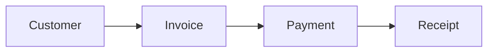

# Invoice payments

| | |
|---|---|
| **Status** | confirmed by the billing lead, 2026-01-12, in the planning call |
| **Ready to plan?** | 2 slices clear, 1 waiting on an rfc - the spec of Receipt cannot start |
| **Blocks go-live** | the provider contract for Payment is cited from memory and must be re-read |
| **Review** | 2026-03-01 - the billing lead |

**How to read.** From Summary to Open is the design the team aligns on. Slices cuts the work: one section per slice, with its rules, its contract and the data that matters.

## Summary

Customers receive invoices by email today and pay by bank transfer, so finance matches payments by hand. This builds online payment of an invoice and a receipt after it. It does not change how invoices are issued.

1. An invoice has one number that never changes.
2. A payment is created once per invoice attempt.
3. A receipt is sent only after the provider confirms the payment.

**What is expensive to get wrong:** the invoice number, because customers quote it to their accountants.

## Context and problem

**Where the project is.** In steady use: invoices already go out every month.

**The pain.** Finance spends two days each month matching bank transfers to invoices, and late payers are found a week late.

**What this reuses.** The existing invoice record and its numbering, unchanged.

## How we will know it worked

| What to watch | Target | How to measure |
|---|---|---|
| Invoices paid online | 60% of invoices within three months | the paid_via column on the invoice record |
| Days finance spends matching | under half a day per month | the monthly close checklist |

**Signs it is going wrong:** payments created and never confirmed, or duplicate receipts.

## Scope

**In**

- paying an invoice online
- sending a receipt after payment

**Out**

| Left out | Why / where it lands |
|---|---|
| refunds | a later design, after the first month of data |

**Unchanged** (so nobody hunts): the invoice number format and the issue date.

## How it works

### Overview

The customer opens an invoice, pays it through the provider, and the provider's confirmation triggers the receipt.

### Data model

| Record | Role | New? | Detail in |
|---|---|---|---|
| `invoice` | what the customer owes | gains `paid_at` | [Invoice](#invoice) |
| `payment` | one attempt to pay an invoice | new | [Payment](#payment) |

### Vocabulary

| Term | Means |
|---|---|
| **attempt** | one try to pay an invoice, which can fail |

## Key decisions

These are the hard-to-reverse decisions; slices cite them by code.

| | Decision | Slices it affects |
|---|---|---|
| D1 | Invoice numbering | Invoice, Payment |
| D2 | Confirmed payment | Payment, Receipt |

### D1 — Invoice numbering

**Rule.** An invoice number is assigned once and never reused or edited.

**Consequence.** Every later record refers to the invoice by that number.

### D2 — Confirmed payment

**Rule.** A payment counts as paid only after the provider confirms it.

**Consequence.** A receipt is sent from the confirmation, never from the customer's click.

## Open

What needs somebody to decide or act before this can ship, each with an owner.

| Item | Where it stands | Blocks | Where |
|---|---|---|---|
| Which sender address the receipt uses | rfc - not decided | the spec of Receipt | [Receipt](#receipt) |
| The provider contract for Payment | cited from memory, not re-read | go-live of Payment | [Payment](#payment) |

## Slices

| Slice | Delivers | Status |
|---|---|---|
| [Invoice](#invoice) | an invoice carries its number and a paid marker | clear |
| [Payment](#payment) | a customer pays an invoice online | clear — go-live waits on the provider contract |
| [Receipt](#receipt) | a receipt is sent after confirmation | blocked by the sender address |

**Order:** Invoice → Payment → Receipt. Nothing runs in parallel.

**Already handled by existing code** (not a task):

- an unpaid invoice → the monthly reminder job

**Left to the spec** (derivable from the repository, all as the invoice record does them): field types and indexes.

---

### Invoice

> **Delivers:** an invoice carries its number and a paid marker.
> **Status:** clear · **Applies:** D1 (Invoice numbering) · **Depends on:** nothing

**Behaviour**

| Situation | What happens | Response |
|---|---|---|
| An invoice is paid | the paid marker is set once | 200 |
| A second payment arrives | the marker stays as it is | 409 already paid |

**Contract**

`GET /invoices/{number}` → `200` the invoice with its paid marker — the customer page.

**Data**

The `invoice` record gains `paid_at`.

| Field or constraint | What it means |
|---|---|
| `invoice.paid_at` | null means unpaid |

---

### Payment

> **Delivers:** a customer pays an invoice online.
> **Status:** clear — go-live waits on the provider contract · **Applies:** D1 (Invoice numbering), D2 (Confirmed payment) · **Depends on:** Invoice

**Behaviour**

| Situation | What happens | Response |
|---|---|---|
| The customer starts a payment | one attempt is created | 201 |
| The provider confirms | the invoice is marked paid | 200 |

**Contract**

`POST /invoices/{number}/payments` → `201` the attempt — the customer page.

**Data**

New record `payment`: one attempt to pay an invoice.

| Field or constraint | What it means |
|---|---|
| `payment.invoice_number` | the invoice the attempt belongs to |

---

### Receipt

> **Delivers:** a receipt is sent after confirmation.
> **Status:** blocked by the sender address · **Applies:** D2 (Confirmed payment) · **Depends on:** Payment

**Behaviour**

| Situation | What happens | Response |
|---|---|---|
| A payment is confirmed | one receipt is sent | n/a |

**Contract**

Event `payment.confirmed` is read by the receipt sender.

**RFC** The sender address - the billing lead - blocks the spec of Receipt. Not decided.

## References

- the invoice numbering rule in the billing handbook — settles D1.
